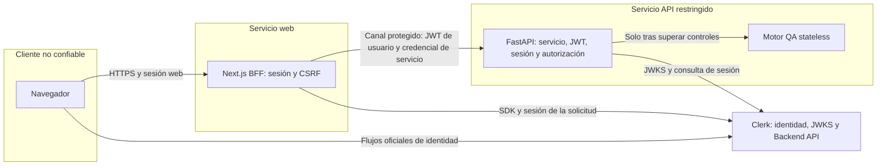

# ADR 0002 — Authentication & Service Trust Architecture

**Proyecto:** KevoLint — n8n QA Self-Hosted.

**Estado:** **ACCEPTED — ARCHITECTURE ONLY / IMPLEMENTATION GATED**.

**Fecha de decisión y registro:** 2026-10-20, America/Lima.

**Propietario y autoridad de aprobación:** KevinhosUTP.

**Repositorio:** `KevinhosUTP/n8n-qa-selfhosted`.

**Baseline:** `develop`, `d27a88e68a3125857618f0231691d2e1ee69cd7a`.

## 1. Alcance de la aprobación y estado

El propietario aprobó la arquitectura del informe «KEVOLINT — D02 · ARCHITECTURE
DECISION RECORD — AUTHENTICATION & SERVICE TRUST» y autorizó exclusivamente su
registro documental. Este ADR conserva sus contratos, límites y condiciones.
La aceptación arquitectónica **no acredita** configuración del tenant, viabilidad
operativa, dependencias aprobadas, aislamiento de red ni autorización de despliegue.

La orden de registro no autoriza instalar Clerk, PyJWT o soporte criptográfico;
implementar autenticación; modificar aplicaciones, contratos históricos, SEC, CI o
infraestructura; ni iniciar SEC-GATE, PR06, PR07 o PR10. Los archivos y mecanismos
futuros de este ADR son propuestas de implementación, no componentes existentes.
Cada incremento requiere autorización independiente, evidencia y revisión de merge.

## 2. Contexto verificado y procedencia

INC-02 está integrado mediante PR #12 en la baseline indicada. El
[CI Linux posterior al merge](https://github.com/KevinhosUTP/n8n-qa-selfhosted/actions/runs/39442734319)
ejecutó satisfactoriamente 66 pruebas Python y el smoke inicial de Streamlit. Esa
ejecución no constituye una nueva validación frontend, de autenticación o de red.

Estado del código inspeccionado para D02:

- Next.js 16.4.2, React 19.3.1, Node 22.20.0, TypeScript, ESLint y Vitest; Clerk
  y axe-core no instalados. La baseline frontend histórica contiene 363 tests;
  no se volvieron a ejecutar como parte de este registro documental.
- Ocho rutas públicas, layout público, BrandLogo, Button, campos nativos,
  Dialog/Drawer/Toast, ModalCore y adaptador del drawer público ya implementados.
  `/sign-in`, `/sign-up`, `/app` y `/api/audits` aún responden 404 en la baseline.
- La configuración pública admite `NEXT_PUBLIC_APP_ORIGIN`; rechaza actualmente
  `NEXT_PUBLIC_CLERK_PUBLISHABLE_KEY`, incluso vacía. Añadir el proveedor exige
  revisar explícitamente validadores y pruebas, sin admitir variables arbitrarias.
- FastAPI ofrece `GET /health` y `POST /api/v1/audits`. La auditoría es síncrona,
  stateless, en memoria y sin autenticación, persistencia, cuotas ni autorización.
  El motor no ejecuta n8n ni realiza llamadas de red o a modelos.
- El Dockerfile API usa Python 3.12, usuario no privilegiado y healthcheck local;
  `EXPOSE 8000` no demuestra publicación de puertos. No hay configuración efectiva
  versionada de Compose, Coolify o Traefik que acredite la topología real.

Fuentes locales: `apps/web/design-system/source/Handoff-tecnico-KevoLint.md`,
`apps/web/docs/accessibility-register.md`, `apps/web/package.json`, rutas/layouts,
`docs/api-contract.md`, `docs/security-backlog.md`,
`.github/security/sec-pr01-01.json`, `apps/api/main.py`, `tests/test_api.py` y
`apps/api/Dockerfile`. Los documentos históricos pueden conservar estados
anteriores a los merges: este ADR no los reescribe ni toma esos estados como
prueba de que el código integrado no exista.

La investigación D02 consultó documentación oficial de Clerk, Next.js, FastAPI,
PyJWT, OWASP, Docker y Traefik. Este registro no repite la auditoría SEC ni verifica
un tenant, VPS o credenciales reales. Las capacidades documentadas por un proveedor
son distintas de las capacidades verificadas en KevoLint.

## 3. Problema y objetivos

Definir un transporte web autenticado y un contrato verificable de identidad,
sesión y confianza entre servicios antes de conectar el frontend al motor QA.
Evitar confianza en cabeceras del navegador, tokens válidos para otra aplicación,
sesiones revocadas observables, rutas internas sin autorización y cachés compartidas
entre usuarios. Distinguir tres controles: autenticación de usuario, autenticación
de servicio y autorización de una operación.

No se resuelven aquí D03 (cuotas durables), D04 (persistencia/propiedad/ciclo de
informes), D05 (catálogo), D06 (retención), D08 (legal) ni las integraciones futuras.
No se inventan tablas, propietarios persistidos, cuotas, IDs de auditoría o APIs
de historial que hoy no existen.

## 4. Decisiones D02-01 a D02-09

| ID | Estado aprobado | Decisión y condición rastreable |
| --- | --- | --- |
| D02-01 | APROBADA | Navegador → Next.js BFF → FastAPI → motor QA. Sin API directa paralela desde el navegador. Implementación sujeta a los gates de este ADR. |
| D02-02 | APROBADA CON CONDICIONES | Token de sesión Clerk personalizado con audiencia KevoLint. Verificar en el tenant emisión, firma, issuer, audience, subject, sesión, tiempos, authorized parties, versión, registro, verificación y MFA. Gate G-TENANT; sin omisiones silenciosas. |
| D02-03 | APROBADA | FastAPI verifica servicio, JWT, identidad, sesión y autorización independientemente del BFF. Sin identidad basada en `user_id`, `X-User-ID` o email recibido; sin fallback anónimo. Gate G-BACKEND. |
| D02-04 | APROBADA CON CONDICIONES | Credencial independiente de servicio + TLS + acceso de red restringido. Verificar puertos, rutas alternativas, redes, terminación TLS, secretos, rotación y salida hacia Clerk. Gate G-CHANNEL. |
| D02-05 | ALTERNATIVA CONDICIONADA | mTLS no obligatorio inicialmente. Si no se acredita el canal principal, bloquear su habilitación y presentar mTLS para autorización operacional separada. No crear CA/certificados ni cambiar Traefik automáticamente. |
| D02-06 | APROBADA CON CONDICIONES OPERATIVAS | Consulta de sesión a Clerk por cada auditoría admitida antes del motor, fail closed, sin caché positiva compartida. Validar cuotas, latencia, disponibilidad, credenciales y consistencia. Sin garantía de revocación instantánea ni fallback silencioso. Gate G-SESSION. |
| D02-07 | PENDIENTE DE VALIDACIÓN | Vida máxima del token, tolerancia temporal, caché JWKS y timeouts son candidatos de prueba; no son configuración definitiva aprobada. Gate G-PARAMETERS. |
| D02-08 | SEC-GATE OBLIGATORIO | SEC-PR01-01 intacta; revisión 24/10/2026; vencimiento 31/10/2026 23:59 America/Lima. Toda dependencia, lockfile o baseline nueva requiere aprobación independiente. Gate G-SEC. |
| D02-09 | CONDICIÓN PENDIENTE | Resolver AXE-PR05-01 y requisitos aplicables de PR05 antes de declarar PR06 listo para integración, salvo desviación formal autorizada. Gate G-A11Y. |

## 5. Arquitectura BFF seleccionada y alternativa descartada

El navegador usa el SDK Clerk y el origen Next.js para las operaciones de KevoLint.
El BFF obtiene el token de la sesión verificada de esa solicitud y llama a un
upstream fijo. FastAPI no confía en el resultado del BFF como sustituto de su
propia verificación. La comprobación de autorización se sitúa junto al recurso y
a la ejecución; `proxy.ts` es un filtro temprano, nunca la única barrera.

| Dimensión | BFF seleccionado | API directa no seleccionada |
| --- | --- | --- |
| Superficie | API restringida al servicio; introduce endpoints Next que también deben protegerse | API accesible al navegador y mayor superficie pública |
| Sesión | Integración web/SSR y transporte centralizados | Cliente gestiona transporte hacia otro origen y renovación |
| Autorización/revocación | Siguen siendo responsabilidad independiente de FastAPI | También requeridas; acceso directo no las simplifica |
| CSRF/CORS | Cookies web exigen defensa CSRF en BFF; no hace falta CORS público en API | Requiere diseñar CORS y exposición de tokens explícitamente |
| Latencia/coste | Un salto adicional, consulta Clerk y doble capacidad operativa | Un salto menos, pero más responsabilidades del cliente y del perímetro API |
| Escalabilidad | Límites, timeouts y concurrencia coordinados BFF/API | Menor proxy de datos, mayor exposición de API |
| Infraestructura | Exige demostrar canal de servicio y aislamiento | Exige publicación segura de API y políticas cross-origin |
| Mantenimiento | Contratos centralizados y frontera de servidor comprobable | Dos superficies públicas con contratos de cliente separados |

No se implementarán ambas opciones ni un fallback directo para resolver fallos
del BFF. Un eventual consumidor externo requerirá otro ADR. BFF no elimina XSS,
robo de sesión ni denegación de servicio; añade complejidad y otro punto de fallo.

## 6. Límites de confianza



El diagrama expresa el objetivo, no la red instalada. La verificación TLS, el
último tramo y las rutas alternativas deben acreditarse en G-CHANNEL. No hay
flecha autorizada navegador → FastAPI. Un usuario autenticado no es un servicio
autorizado, y un servicio autenticado no acredita por sí solo a ningún usuario.

## 7. Contrato de identidad Clerk y JWT

Perfil objetivo: **token de sesión ordinario Clerk, personalizado con `aud` para
KevoLint**. No usar un JWT template independiente como sustituto: la documentación
consultada distingue los templates no vinculados a sesión y sus restricciones
sobre `sid`/versión. La audiencia no se presupone en el token por defecto.

| Elemento | Contrato objetivo y evidencia requerida |
| --- | --- |
| Tipo de token | Solo sesión de usuario; no aceptar genéricamente tokens OAuth, M2M o API keys. Probar perfil emitido real, versión y vinculación a sesión. |
| Firma/algoritmo | Verificación criptográfica con RS256 fijado para el perfil validado; no elegir algoritmos desde un header no confiable, ni admitir `none` o confusión HS/RS. Confirmar algoritmo real en G-TENANT. |
| `iss` | Coincidencia exacta con issuer configurado y autorizado; no deducir un servidor confiable del propio token. |
| `aud` | Audiencia dedicada, obligatoria y validada. Objetivo de una audiencia explícita; verificar forma real emitida. Si el tenant no la permite, reabrir D02, no quitar la comprobación. |
| `azp` | Obligatorio para este perfil web; coincidencia exacta con origen autorizado. Confirmar emisión en todos los flujos. La permisividad general del proveedor no autoriza omitirlo aquí. |
| `sub`, `sid` | Strings no vacíos; sujeto y sesión asociados coherentemente por la consulta de Backend API. Principal estable compuesto por issuer y subject; sid como contexto de sesión. |
| `exp`, `nbf`, `iat` | Tipos numéricos válidos, sin aceptar booleanos como números; validez temporal, orden y edad máxima según perfil y parámetros pendientes. |
| Versión y estado | Perfil objetivo v2 validado en tenant. Sesión pendiente no puede auditar; rechazar impersonación/delegación no aprobada. Comprobar claims efectivos, no inventar los ausentes. |
| Datos no autoritativos | Email, metadatos editables, etiquetas de plan, IDs en body y cabeceras del navegador no sustituyen identidad ni conceden permisos comerciales. |

El SDK servidor obtendrá el token de la misma solicitud/sesión verificada. No usar
un token global, un usuario cacheado o un token elegido por el cliente. No copiar
JWT a localStorage, sessionStorage, logs ni HTML de la aplicación.

La cookie Clerk `__session` documentada es accesible a JavaScript; no es correcto
declararla HttpOnly ni afirmar que el BFF elimina el acceso del navegador al token.
Las cookies del proveedor se gestionarán mediante el SDK y su configuración
aprobada, sin reemplazar sus mecanismos con cookies caseras.

## 8. Verificación independiente FastAPI y autorización

Secuencia objetivo, sin ejecutar el motor antes de completarla:

1. Límites preliminares de transporte/recursos, sin confiar en Content-Length.
2. Autenticar credencial de servicio y rechazar cabeceras ambiguas o duplicadas.
3. Extraer un único bearer de usuario mediante un contrato inequívoco.
4. Resolver una clave desde JWKS configurado y verificar firma y algoritmo fijo.
5. Validar issuer, audience, authorized party, claims temporales y perfil de sesión.
6. Aplicar protección técnica de abuso antes de amplificar llamadas al proveedor.
7. Consultar la sesión Clerk; comprobar correspondencia `sid`/`sub`, estado activo
   y vigencia antes de admitir la ejecución.
8. Construir principal interno verificado y autorizar la operación solicitada.
9. Aplicar validación existente del workflow y ejecutar el motor una vez.

Los extractores FastAPI `HTTPBearer`/`APIKeyHeader` no verifican criptografía ni
secretos por sí solos. Configurar extracción y errores deliberadamente para
preservar el contrato de estados HTTP. Nunca permitir acceso anónimo por una
variable de contingencia o para conseguir que pasen las pruebas.

JWKS procede exclusivamente de configuración confiable con TLS verificado; no
seguir URLs `jku`/`x5u` del JWT. Rechazar algoritmos o extensiones críticas no
admitidos. Limitar tamaño del token, respuestas JWKS, frecuencia de refresh y
concurrencia. Un `kid` desconocido no debe producir una llamada ilimitada por
solicitud; coordinar actualizaciones y probar rotación legítima.

Se puede cachear el conjunto JWKS con TTL acotado y política de rotación probada,
no la aceptación del JWT ni la autorización de usuario. Una clave utilizable en
caché vigente permite verificar durante un fallo de red; si falta evidencia
vigente indispensable, fallar cerrado. JWKS actualizado sin el `kid` requerido
implica token no válido; indisponibilidad que impide verificar implica dependencia
no disponible. No conservar indefinidamente claves retiradas.

En la evaluación de PyJWT, la caché por clave de `PyJWKClient` no tiene TTL propio;
no habilitarla como sustituto del TTL del conjunto. La biblioteca, soporte crypto,
límites y estrategia efectiva todavía requieren SEC-GATE y pruebas. No se ha
instalado ni seleccionado una versión definitiva mediante este ADR.

Hoy solo se autorizará conceptualmente «crear auditoría» a una sesión admisible.
Propiedad de informes, permisos de lectura y cuotas durables quedan para D03/D04.
Cuando exista persistencia, la autorización por propietario debe ejecutarse en
backend; filtrar el UI no es protección. No devolver datos de otro usuario ni
distinguir públicamente recurso ajeno de inexistente en ese contrato futuro.

## 9. Autenticación y protección entre servicios

| Opción | Evaluación y decisión |
| --- | --- |
| mTLS con Traefik | Identidad del cliente criptográfica y mayor coste de CA, emisión, rotación, revocación, conexión y operación. Alternativa condicionada, sin ejecución automática. Exigir verificación real del certificado cliente, no solicitud opcional sin validación. |
| Red privada solamente | Reduce exposición, pero no autentica servicio: otros contenedores, rutas o un host comprometido pueden alcanzar la API. Insuficiente como mecanismo único. |
| Credencial explícita + TLS + red restringida | Arquitectura inicial aprobada con condiciones. Menor complejidad de MVP; conserva riesgo de replay si se filtra el bearer y requiere rotación, límites y comprobación del canal. |

La credencial de servicio será independiente de `CLERK_SECRET_KEY` y del JWT del
usuario, con entropía criptográfica adecuada; propuesta mínima de 256 bits a
confirmar en implementación. ID de clave no secreto, comparación segura del
secreto y principal técnico limitado a la operación autorizada. El BFF construye
sus cabeceras y elimina identidad/credenciales de servicio entrantes del navegador.
FastAPI no convierte cabeceras «internas» en autoridad sin autenticación.

Usar upstream fijo, sin URLs arbitrarias ni redirecciones que filtren credenciales.
No introducir un protocolo propio de HMAC, nonce, firma de peticiones o JWT de
servicio. TLS protege el transporte; no aporta por sí solo idempotencia ni impide
replay de una credencial robada. Las auditorías repetidas y el abuso requieren
límites técnicos; cuotas comerciales e idempotencia durable quedan fuera de D02.

Rotación propuesta: admitir nueva clave en API, cambiar BFF y retirar la anterior
en una ventana explícita y acotada. Revocación de emergencia puede interrumpir
servicio; no mantener la clave vieja como fallback indefinido. Separar dev/prod,
restringir acceso y excluir secretos de repositorio, logs, errores y cliente.

Compartir VPS no demuestra privacidad. Si TLS termina en Traefik y el tramo final
es HTTP, documentar el límite exacto y acreditar su aislamiento; no llamarlo TLS
extremo a extremo. Entre hosts, proteger también el transporte entre ellos. Si no
se demuestra protección suficiente, bloquear tráfico real y solicitar evaluación
y autorización separada de mTLS; esta decisión no autoriza certificados o red.

## 10. Sesiones y revocación

| Evento | Comportamiento objetivo |
| --- | --- |
| Registro, login, verificación, recuperación, MFA | Flujos oficiales Clerk y configuración real aprobada; sin formularios que simulen éxito ni implementación propia de contraseñas/MFA. Estado pendiente no concede auditorías. |
| Renovación | SDK oficial mantiene sesión; el BFF solicita token actual de la solicitud. No reutilizar token global o de otra cuenta. |
| Expiración o logout | Rechazar operación privada; limpiar estado privado del cliente y caches propios. Refrescar/atrás no debe mostrar información de la sesión anterior. |
| Cambio de usuario | Separar resultados por principal/sesión y descartar respuestas tardías de A después de entrar B. |
| Múltiples sesiones | Verificar cada `sid` y su usuario; revocar una sesión no equivale necesariamente a revocar todas. Probar ambas políticas reales del tenant. |
| Revocación observada | Una consulta de Backend API por auditoría admitida antes del motor, sin caché positiva compartida. Estado no activo impide la operación. |
| Fallo Clerk | Fallar cerrado si no se puede acreditar sesión; no pasar a verificar solo firma ni habilitar modo anónimo. |
| `returnTo` | Destino local permitido y normalizado; rechazar URLs externas, esquemas, formas `//`, variantes codificadas o ambiguas. Evitar bucles y open redirects. |

Se adopta como objetivo `getSession(sid)` una vez por POST de auditoría admitido,
no por render, recurso estático, regla o finding. Contrastar ID de sesión, usuario,
estado y vigencia. Antes de implementarlo deben medirse límites/cuotas de Backend
API, latencia, coste, disponibilidad y protección frente a amplificación, y
aprobarse la ubicación y acceso de la credencial Clerk en FastAPI.

La consulta reduce la ventana respecto de verificar únicamente JWT de corta vida,
pero depende de propagación del proveedor y deja una carrera entre consulta y
ejecución. **No garantiza revocación instantánea global** ni cancela una auditoría
que ya empezó. Cortar la petición HTTP no detiene necesariamente el trabajo
síncrono en threadpool. No se incorpora denylist persistente, webhook o caché
positiva alternativa de forma implícita. Si el enfoque no es sostenible, reabrir
D02-06 con otra propuesta formal antes de implementarla.

## 11. CSRF, CORS, cookies, caché y protección web

- BFF de mismo origen para operaciones de KevoLint. En POST exigir `Origin`
  presente y exactamente igual al origen configurado; rechazar ausente, `null`,
  extranjero o ambiguo. No derivar la lista confiable de `Host`/cabeceras del cliente.
- Exigir JSON y cabecera AJAX propia, con política CORS que no autorice orígenes
  ajenos con credenciales. Fetch Metadata y SameSite son defensas adicionales,
  no sustitutos de validación de origen y sesión. Subdominios del mismo site no
  son automáticamente orígenes confiables.
- Las rutas/callbacks oficiales Clerk necesitan su contrato SDK específico; no
  aplicar una regla casera indiscriminada que rompa los flujos del proveedor.
- FastAPI no necesita CORS público para el navegador en la arquitectura elegida.
  El BFF no reenvía cookies del navegador a FastAPI.
- Guardas servidor junto al acceso a datos y Route Handlers, además del proxy.
  No iniciar un segundo camino mediante Server Actions; si se autorizan después,
  también deberán verificar identidad, CSRF aplicable y autorización.
- `Cache-Control: no-store` para datos privados y sus errores. Identidad limitada
  a solicitud; sin caché global de principal ni respuestas compartidas entre
  usuarios. Probar SSR, navegación, logout, refresh y respuestas concurrentes.
- Renderizar workflow y findings como texto; sin HTML arbitrario, eval o scripts
  del contenido. Revisar CSP y cabeceras con los flujos Clerk antes de habilitarlos;
  hoy no existe CSP que pueda darse por suficiente. Evitar duplicación/conflictos
  entre cabeceras Next y perímetro.
- Proteger páginas privadas sin enviar contenido sensible antes de la decisión
  servidor. No ejecutar auditorías mediante GET, SSR o precarga de enlaces.

El BFF conserva el límite de cuerpo actual de API: 1.048.576 bytes de envelope
UTF-8, incluido overhead, sin confiar exclusivamente en Content-Length. Evitar
que `JSON.parse`/`stringify` conviertan silenciosamente enteros grandes y alteren
las validaciones INC-02; definir transporte/validación que preserve su significado
y probar las respuestas completas. No ampliar límites por conveniencia del cliente.

Coordinar presupuestos de timeout de proxy/BFF/API/Clerk con el motor síncrono.
No reintentar automáticamente auditorías cuando el resultado sea incierto.
Cancelar transporte al desconectar el usuario no equivale a cancelar ejecución.
Logs limitados a request ID, resultado, duración y código sanitizado: sin workflow,
findings privados, JWT, cookies, cabeceras Authorization o respuestas crudas Clerk.
No registrar email o atributos de usuario innecesarios.

## 12. Modelo de errores y preservación del contrato

| Estado | Contrato objetivo | Estado en la baseline |
| --- | --- | --- |
| 400 | JSON malformado, respuesta controlada | Existente en validación API |
| 401 | Sesión ausente, JWT inválido/expirado o sesión revocada observada | Nuevo para autenticación |
| 403 | CSRF, operación prohibida o cuenta no habilitada | Nuevo; distinguir integración y permisos |
| 404 | Recurso privado inexistente o ajeno, cuando exista persistencia | Contrato futuro D04; no hay informes almacenados |
| 413 | Cuerpo excede límite | Existente |
| 415 | Tipo de contenido no admitido | Existente |
| 422 | Workflow inválido, incluidas DEF-01/DEF-02 | Existente, preservar respuestas y validaciones |
| 429 | Límite técnico local atribuible a la solicitud; Retry-After según contrato | Nuevo; no representa cuota comercial |
| 500 | Fallo interno sanitizado | API controla fallos del motor; no afirmar que todo error actual esté sanitizado |
| 502 | Upstream inválido o fallo de transporte hacia API | Nuevo en BFF |
| 503 | Proveedor/JWKS necesario indisponible, sin evidencia verificable suficiente | Nuevo; fail closed |
| 504 | Timeout de upstream | Nuevo en BFF |

Un fallo de credencial de servicio es un problema de integración: API lo rechaza,
pero BFF no debe convertirlo en «usuario deslogueado» ni exponer detalles internos.
Un límite global Clerk no debe atribuirse automáticamente como 429 del usuario.
La traducción exacta de errores upstream y el envelope nuevo se definirán y
probarán antes de implementar, sin alterar silenciosamente el contrato actual.

La respuesta válida actual conserva `engine_version`, `metrics` y `findings`,
severidades `CRÍTICO`/`ADVERTENCIA`/`OK` y nombres reales de los cuatro motores.
No añadir estados de job, IDs, historial ni timestamps ficticios. Separar DTO wire
de presentación; comprobar respuesta completa, no solo conteos o status.

## 13. Configuración propuesta y parámetros pendientes

Solo nombres, sin valores de credenciales ni datos del tenant:

| Ámbito | Nombres propuestos |
| --- | --- |
| Públicos web autorizables | `NEXT_PUBLIC_APP_ORIGIN`, `NEXT_PUBLIC_CLERK_PUBLISHABLE_KEY` |
| Secretos Clerk servidor | `CLERK_SECRET_KEY` |
| Perfil verificador servidor | `CLERK_ISSUER`, `CLERK_JWKS_URL`, `CLERK_AUDIENCE`, `CLERK_AUTHORIZED_PARTIES` |
| Upstream Next servidor | `KEVOLINT_API_ORIGIN`, `KEVOLINT_API_TIMEOUT_MS` |
| Servicio Next/API | `KEVOLINT_SERVICE_KEY_ID`, `KEVOLINT_SERVICE_KEY` |
| Rotación opcional y acotada | `KEVOLINT_SERVICE_KEY_PREVIOUS_ID`, `KEVOLINT_SERVICE_KEY_PREVIOUS`, `KEVOLINT_SERVICE_KEY_PREVIOUS_EXPIRES_AT` |
| Solo contingencia mTLS autorizada | `KEVOLINT_API_CLIENT_CERT_FILE`, `KEVOLINT_API_CLIENT_KEY_FILE`, `KEVOLINT_API_CA_FILE` |

Son nombres de diseño, no variables ya implementadas ni opciones que el SDK
reconozca automáticamente. El publishable key es público por diseño; las claves
secretas no pueden usar prefijo público ni serializarse a cliente/build. Determinar
qué proceso requiere cada secreto y limitar su distribución. No reutilizar la
credencial Clerk como credencial de servicio. Rutas de archivos mTLS no autorizan
guardar claves privadas en repositorio.

D02-07 conserva como **candidatos de prueba, no valores definitivos aprobados**:
vida máxima de JWT de 60 segundos, tolerancia temporal de hasta 5 segundos, TTL
JWKS de 300 segundos y timeouts de red de 2 segundos por dependencia. Verificar
emisión real, renovación, reloj, rotación y latencia antes de fijarlos. También
faltan presupuesto total de auditoría, cooldown y límites de refresh/concurrencia,
tamaños máximos de token/JWKS y ventana de rotación. No derivar una configuración
de producción de defaults de bibliotecas o de estos números sin G-PARAMETERS.

## 14. Matriz adversarial y evidencias requeridas

No se ejecutaron estas pruebas de autenticación en D02: describen evidencia
obligatoria futura. JWT fabricados con mocks no serán la única prueba. Usar claves
RSA efímeras y JWKS local controlado para criptografía; después tenant autorizado,
HTTP real, navegador y pruebas del canal desplegable sin divulgar credenciales.

| # | Caso / entrada | Capa y resultado esperado | Evidencia / incremento |
| --- | --- | --- | --- |
| 1 | Sesión válida, aud/azp correctos y servicio válido | BFF/API: operación autorizada, motor una vez y contrato íntegro | JWT firmado, HTTP y tenant real; PR06, PR10-AUTH/BFF |
| 2 | Sin sesión | BFF/API: 401; sin motor | HTTP directo y navegador; PR06, PR10-AUTH/BFF |
| 3 | JWT expirado, futuro o mal tipado | API: 401; validar límites temporales | Reloj de tests, firmas reales y casos frontera; PR10-AUTH |
| 4 | Payload modificado | API: 401 sin usar claims manipulados | Alterar JWT firmado; PR10-AUTH |
| 5 | Firma/clave/algoritmo incorrectos | API: 401; rechazar none y confusión HS/RS | Criptografía real y claves diferentes; PR10-AUTH |
| 6 | Issuer ajeno | API: 401 sin descubrir URLs del atacante | JWKS/HTTP instrumentados; PR10-AUTH |
| 7 | Audience ausente o incorrecta | API: 401 sin fallback | Tokens firmados y perfil tenant; PR10-AUTH |
| 8 | azp ausente/ajeno, versión/estado/delegación no admitidos | API: 401 o 403 según contrato validado; sin motor | Matriz de perfil y flujos Clerk; PR06, PR10-AUTH |
| 9 | Sesión revocada con JWT aún vigente | API: denegar tras consulta; sin promesa instantánea | Revocación y getSession reales, medir propagación; PR10-AUTH |
| 10 | JWKS caído/caducado, kid desconocido o clave rotada | API: 503 si no puede verificar; 401 si conjunto vigente no admite clave; sin tormenta de refresh | Fallos/rotación/concurrencia y caché acotada; PR10-AUTH |
| 11 | Usuario A cambia a B con respuesta de A pendiente | Web/API: aislamiento, descartar resultado tardío | Navegador y HTTP concurrente; PR06/07/10-BFF |
| 12 | Origin ausente/null/externo, Content-Type o cabecera inválidos | BFF: rechazo CSRF/formato sin upstream | HTTP y navegador, incluido subdominio no autorizado; PR10-BFF |
| 13 | Acceso directo a API desde navegador/red ajena | Red/API: bloqueo de red o rechazo de servicio; sin motor | Prueba externa e interna real; G-CHANNEL, PR10-AUTH/BFF |
| 14 | user_id/X-User-ID/email falsificados | API: ignorar como autoridad; principal del JWT verificado | HTTP y spy de principal/motor; PR10-AUTH |
| 15 | JWT válido sin credencial de servicio o con credencial incorrecta | API: rechazo; BFF no fuerza logout por error de integración | HTTP y prueba del canal; PR10-AUTH/BFF |
| 16 | Usuario válido solicita informe ajeno | Backend futuro: 404 sin fuga de existencia | Dos usuarios y persistencia real; futuro D04, no afirmar cobertura actual |
| 17 | Timeout Clerk/API o desconexión de cliente | BFF/API: 503/504 según origen; sin retry automático ni falsa cancelación del motor | Transporte real con retrasos/cortes; PR10-AUTH/BFF |
| 18 | Abuso concurrente y límite técnico/proveedor | Perímetro/API: límites acotados, no amplificar Backend API; sin cuotas inventadas | Carga controlada y Retry-After; G-SESSION/CHANNEL, PR10-AUTH/BFF |
| 19 | Logout, refresh, returnTo malicioso y atrás/adelante | Web: sin datos privados ni open redirect | Navegador con cuentas reales autorizadas; PR06/07/10-BFF |
| 20 | Caché compartida entre usuarios/SSR | Web/API: no-store y sin mezcla de principal/respuesta | Cabeceras, SSR y secuencia A/B; PR06/07/10-BFF |
| 21 | Fallos con JWT/secretos/workflow como entrada | Todas: ninguna fuga en logs, errores, HTML o bundles | Canarios sintéticos e inspección de artefacto/logs; todos los incrementos |
| 22 | Usuarios/sids simultáneos, renovación/rotación | Todas: identidad por solicitud, límites y estados consistentes | HTTP paralelo y navegador; PR06, PR10-AUTH/BFF |

Añadir sesiones pendientes, formularios de registro/verificación/MFA según tenant,
cabeceras duplicadas, cuerpos streaming > límite, enteros extremos de INC-02,
salida upstream inválida, rotación/revocación de servicio y clausura de rutas
alternativas. Comprobar que 400/413/415/422 y las respuestas válidas no cambian por
la introducción de autenticación: adaptar el harness para sesiones autorizadas,
sin deshabilitar seguridad ni borrar aserciones existentes.

Conservar las 66 pruebas Python, las 363 frontend de baseline, smoke Streamlit,
lint, TypeScript, frontera cliente/servidor, build, smoke Next y suites navegador
PR02–PR05b. Verificar recursos originales, responsive, foco del drawer y rutas
públicas. `RouteFocus` requiere pruebas con auth para evitar competir con foco del
proveedor. No instalar nuevos runners o SDKs de testing automáticamente. Testing
tokens Clerk para bots no sustituyen identidad ni evidencia de sesión real.

## 15. Requisitos de infraestructura y operación

G-CHANNEL deberá entregar un inventario sanitizado, verificable y sin secretos de:

- Servicios/hosts, redes Docker compartidas, routers Traefik y rutas alternativas.
- Puertos efectivamente publicados, acceso al 8000 y reglas que impiden bypass.
- Origen upstream fijo, identidad TLS verificada, punto de terminación y cada
  tramo posterior; versión/configuración efectiva de Traefik, sin asumirla.
- Restricciones de acceso y salida hacia JWKS y Backend API Clerk. Una red Docker
  `internal` puede cortar esa salida; no activarla a ciegas como solución completa.
- Gestión, distribución mínima, separación dev/prod y rotación de secretos;
  tratamiento de emergencia, logs y límites técnicos.
- Presupuestos de timeout/cuerpo y pruebas de solicitudes directas no autorizadas.

`/health` conserva su función de liveness para monitorización local autorizada,
sin JWT ni consulta Clerk. No permitir bypass por prefijo `/health*`, ni afirmar
que un 200 de liveness acredita autenticación, readiness del proveedor o despliegue
seguro. Su exposición externa requiere decisión de perímetro.

No hay autorización actual para modificar Coolify, Traefik, DNS o contenedores.
La implementación documental o un build correcto no satisfacen estas condiciones.
Si se documenta infraestructura en el repositorio en una etapa autorizada, los
candidatos son `apps/web/Dockerfile`,
`infrastructure/docker/compose.kevolint.yml`,
`infrastructure/traefik/kevolint-private.yml` y
`docs/operations/service-trust.md`; todavía no existen por decisión de este ADR.

Rollback solo a una versión con autenticación y canal previamente verificados.
La primera integración no tiene una versión anterior autenticada: cerrar ingreso
antes de volver al backend sin auth; nunca «resolver» un fallo desactivando las
guardas. Preparación y ejecución operacional requieren autorización independiente.

## 16. SEC-GATE y dependencias

SEC-PR01-01 continúa **temporalmente aceptada, no corregida**, con propietario
KevinhosUTP. Se conserva la cadena exacta exclusivamente de desarrollo:

`@next/eslint-plugin-next@16.4.2 → fast-glob@3.3.1 → micromatch@4.0.8 → braces@3.0.3`.

Advisory `GHSA-vfj7-8cjw-p6xm`, CVE `CVE-2026-93687`. Hash autorizado del lockfile
según la política existente:
`aa92474f1c300f4dd062af76381c793bef5f4e9440901d17f030b374df5054a5`.
El registro de D02 no cambia el lockfile, ese hash, los scripts o la política.

Revisiones previstas: **24 y 31 de octubre de 2026**. Vencimiento exacto:
**31/10/2026 23:59:00 America/Lima = 01/11/2026 04:59:00 UTC**.
No hay renovación automática ni se crea otra tarea de revisión. B1, B1.1, C1 y C2
están descartadas; no se reabren parches, forks o adaptadores personalizados.

Conservar audit completo con desarrollo y evaluación fail closed ante hallazgos
nuevos, cambios de cadena, configuración, hash, contexto, proceso o evidencia.
La aceptación solo es elegible en los contextos exactos ya autorizados de pushes
a develop y PR internos hacia develop a través del workflow aprobado; no main,
forks, producción o despliegue. Main conserva escaneo estricto y puede fallar
intencionalmente mientras persista el hallazgo. No simular variables GitHub.

Exigir foundation Linux e inventario/artefacto del mismo commit: paquetes físicos,
assets, trazas, imports, firmas y enlaces; la ausencia en `audit --omit=dev` no es
evidencia suficiente. La cadena no puede trasladarse al ejecutable de producción.
Un audit limpio por sí solo no demuestra remediación, y retirar la excepción o
renovar la baseline exige autorización explícita y evidencia reproducible.

Clerk modifica dependencias/lockfile y rompe la baseline actual; cambiar únicamente
su hash no remedia braces. La compatibilidad declarada de peers no sustituye un
árbol resuelto, audit completo, build y regresiones. La investigación consultó
`@clerk/nextjs` 7.9.17 y PyJWT 2.15.1 como referencias, no como instalaciones o
versiones autorizadas. El soporte criptográfico y dependencias transitivas Python
deben revisarse por separado: npm audit no cubre Python. `httpx` está actualmente
en requisitos de desarrollo, no en la imagen runtime API; una consulta Clerk en
runtime necesita una decisión explícita de cliente y dependencias.

Si vence la aceptación o aparece otra anomalía, los controles deben bloquear; no
silenciar audit, reducir reglas o usar un bypass para instalar autenticación.
Este ADR no inicia la revisión SEC ni concede una excepción nueva.

## 17. Estructura propuesta de implementación

Archivos candidatos; **ninguno se crea mediante este ADR** salvo el propio ADR.
Mantener contratos mínimos y reutilizar componentes existentes sin reconstruirlos.

```text
apps/web/src/proxy.ts
apps/web/src/components/auth/AuthProvider.tsx
apps/web/src/components/auth/AuthPage.tsx
apps/web/src/app/(public)/(auth)/layout.tsx
apps/web/src/app/(public)/(auth)/sign-in/[[...sign-in]]/page.tsx
apps/web/src/app/(public)/(auth)/sign-up/[[...sign-up]]/page.tsx
apps/web/src/app/(private)/app/layout.tsx
apps/web/src/app/(private)/app/page.tsx
apps/web/src/app/(private)/app/loading.tsx
apps/web/src/app/(private)/app/error.tsx
apps/web/src/lib/auth/server.ts
apps/web/src/lib/auth/return-to.ts
apps/web/src/lib/http/private-response.ts
apps/web/src/lib/api/audit-contract.ts
apps/web/src/lib/api/audits.server.ts
apps/web/src/app/api/audits/route.ts
apps/web/tests/auth.test.ts
apps/web/tests/audit-contract.test.ts
apps/api/auth/__init__.py
apps/api/auth/config.py
apps/api/auth/principals.py
apps/api/auth/service.py
apps/api/auth/clerk.py
apps/api/auth/dependencies.py
tests/auth_test_support.py
tests/test_api_auth.py
tests/test_api_service_trust.py
docs/operations/service-trust.md
```

Archivos existentes a revisar en los incrementos autorizados: config pública y
servidor Next, layout raíz, catálogo de rutas, pruebas de configuración/smoke,
package/lockfile tras SEC-GATE, `apps/api/main.py` y requisitos API tras aprobación
Python. No modificar el motor para integrar auth. Cambios de CI o infraestructura
necesitan su alcance explícito; no se presuponen autorizados por esta lista.

BrandLogo, Button, campos, Alert, Skeleton y EmptyState pueden reutilizarse sin
duplicar primitivas. Las superficies privadas nuevas no deben usar ModalCore o el
drawer público como vía para omitir controles de servidor. Mantener tokens y SVG
originales, temas completos no validados deshabilitados y navegación pública.

## 18. Plan incremental y condiciones de integración

Todos los pasos siguientes son futuros salvo el registro local de este ADR.
Ninguno se considera implementado o autorizado para comenzar por figurar aquí.

| Incremento | Dependencias y archivos principales | Exclusiones / riesgos | Evidencia y condición de aceptación/merge |
| --- | --- | --- | --- |
| D02-ADR | Este ADR sobre baseline aprobada | Solo documentación; sin código, secretos ni SEC | Nueve decisiones fieles, gates visibles y alcance de un archivo. Registro local; staging/commit/publicación requieren nueva orden. |
| SEC-GATE | Decisión independiente sobre baseline; manifiestos, lockfile y controles solo con autorización | No ampliar vigencia, ocultar findings ni reabrir parches descartados | Árbol e integridades reproducibles, audit completo, exposición y artefacto Linux, regresiones; aprobación específica de dependencias y cualquier cambio de política. No iniciado por esta orden. |
| PR06 | D02 aprobado, G-SEC, G-TENANT y G-A11Y o desviación formal; AuthProvider/AuthPage, rutas auth, helpers, proxy y config | Sin motor, BFF de auditorías, pagos ni dashboard ficticio. Riesgos de tenant, cookies, foco y caché | Login/registro/recuperación reales, returnTo, expiración/logout/cambio de cuenta, sesión servidor y tests. Antes de integración resolver gates y CI del último SHA; merge separado autorizado. |
| PR10-AUTH | D02, dependencia Python aprobada, perfil real G-TENANT, G-SESSION/PARAMETERS y contrato de servicio | Sin rediseño QA, cuotas ni persistencia; riesgo de disponibilidad Clerk y rotación | Verificación criptográfica y sesión independiente, auth de servicio, pruebas HTTP/adversariales y 66 regresiones preservadas. No habilitar servicio real sin G-CHANNEL; autorización específica de merge. |
| PR07 | PR06 integrado y diseño AppShell aprobado | Sin datos comerciales inventados ni llamadas de auditoría como efecto de render | Layout privado, navegación/loading/error, no-store, aislamiento y responsive/a11y; sin regresiones públicas y CI satisfactorio. Merge autorizado por separado. |
| PR09 | PR07 y contrato de entrada INC-02 | Importación JSON local; sin fingir ejecución ni persistencia | Límites UTF-8/envelope, tipos/enteros, errores accesibles y datos efímeros; motor aún no llamado salvo posterior PR10-BFF. Merge específico. |
| PR10-BFF | PR06/07/09, PR10-AUTH, G-CHANNEL, G-SESSION, G-PARAMETERS y contrato común | Sin API directa, fallback anónimo, retry ciego, cuotas o historial ficticios | End-to-end tenant → BFF → API → motor, CSRF, canal, sesión, timeout, respuestas completas y ausencia de fuga; todos los gates, CI Linux último SHA y autorización de merge. Despliegue requiere otra autorización. |

PR10-AUTH puede prepararse antes de PR07/09 tras sus propios gates; PR10-BFF debe
esperar tanto la verificación backend como el flujo frontend y el canal demostrado.
No agrupar autenticación, infraestructura y toda la aplicación privada en un PR.

Reparto futuro propuesto: Codex frontend en `apps/web/`; Antigravity backend en
`apps/api/auth/`, integración de endpoint y tests Python. Congelar primero contrato
de JWT, headers, errores y DTO. Un responsable por lockfile/manifiesto, CI, ADR y
contrato compartido; evitar edición simultánea. La coordinación no autoriza abrir
tareas, enviar mensajes ni iniciar agentes o implementación automáticamente.

## 19. Riesgos, decisiones pendientes y criterios de desbloqueo

| Gate | Evidencia pendiente y responsable propuesto | Condición para desbloquear |
| --- | --- | --- |
| G-TENANT / D02-02 | Propietario autoriza acceso/configuración; responsable de identidad comprueba token real, registro/verificación/MFA, audiencia, azp, sid, versión y firma | Perfil completo emitido y validado en todos los flujos; sin relajar claims para adaptarse al tenant. |
| G-BACKEND / D02-03 | Responsable backend implementa verificación independiente y autorización bajo orden posterior | JWT/servicio/sesión verificables con pruebas reales, sin bypass ni confianza en identidad enviada por cliente. |
| G-CHANNEL / D02-04/05 | Propietario/operador acredita topología, puertos, rutas, TLS, secretos, rotación y egress | Canal principal demostrado; si falla, servicio bloqueado y propuesta mTLS separada. |
| G-SESSION / D02-06 | Propietario/operador y backend verifican cuotas BAPI, coste, latencia, fallos y consistencia | Consulta por auditoría sostenible y fail closed, sin caché positiva ni fallback; alternativa requiere reabrir decisión. |
| G-PARAMETERS / D02-07 | Responsables web/API/operación prueban tiempos, rotación, límites y concurrencia | Parámetros documentados y aprobados tras medición; candidatos no pasan a configuración definitiva automáticamente. |
| G-SEC / D02-08 | Propietario y revisión de seguridad autorizan nueva baseline y dependencias | Evidencia completa y reproducible sin debilitar controles, antes del vencimiento o decisión formal sin extensión automática. |
| G-A11Y / D02-09 | Propietario resuelve AXE-PR05-01 y requisitos PR05 aplicables | Gate satisfecho o desviación formal antes de declarar PR06 listo para integración. No declarar conformidad WCAG integral. |

Riesgos residuales: sesión JS accesible y XSS; robo/replay de bearer de servicio;
host compartido comprometido; disponibilidad/consistencia/límites Clerk; carrera
entre revocación y ejecución; caché JWKS y demora de rotación; operación síncrona
no cancelable de forma garantizada; errores de caché/usuario concurrente; y la
vulnerabilidad de desarrollo todavía aceptada temporalmente. Los controles reducen
esos riesgos, no prueban su inexistencia.

Continúan pendientes lectores de pantalla reales, zoom nativo y plataformas
adicionales; CHOICE-REACT-RESET-01 permanece documentada. Los hallazgos visuales
Checkbox/Switch están cerrados según su registro y no se reabren ni se modifican
aquí. PR05 global sigue abierto por sus gates restantes. D05/D08 y el bloqueo de
despliegue comercial no se levantan por aprobar autenticación.

**Conclusión de estado:** arquitectura aceptada; implementación y operación
condicionadas. Solo el propietario puede autorizar los incrementos y resolver
desviaciones. No se inicia SEC-GATE ni PR06 con este registro. No se autorizan
publicación, merge o despliegue mediante el ADR.

## 20. Referencias oficiales de la investigación D02

Referencias consultadas para el informe original del 20/10/2026. Son documentación
externa y deben revalidarse al implementar; no demuestran estado del tenant o VPS.

- Clerk: [session tokens](https://clerk.com/docs/guides/sessions/session-tokens),
  [personalización de sesión](https://clerk.com/docs/guides/sessions/customize-session-tokens),
  [JWT templates](https://clerk.com/docs/guides/sessions/jwt-templates),
  [verificación manual](https://clerk.com/docs/guides/sessions/manual-jwt-verification),
  [cookies y funcionamiento](https://clerk.com/docs/guides/how-clerk-works/overview).
- Clerk servidor: [authenticateRequest](https://clerk.com/docs/reference/backend/authenticate-request),
  [Next middleware/proxy](https://clerk.com/docs/reference/nextjs/clerk-middleware),
  [auth App Router](https://clerk.com/docs/reference/nextjs/app-router/auth),
  [getSession](https://clerk.com/docs/reference/backend/sessions/get-session),
  [Backend Session](https://clerk.com/docs/reference/backend/types/backend-session),
  [testing](https://clerk.com/docs/guides/development/testing/overview).
- Next.js: [autenticación](https://nextjs.org/docs/app/guides/authentication),
  [Route Handlers](https://nextjs.org/docs/app/api-reference/file-conventions/route),
  [proxy](https://nextjs.org/docs/app/api-reference/file-conventions/proxy).
- FastAPI: [seguridad](https://fastapi.tiangolo.com/tutorial/security/) y
  [extractores de seguridad](https://fastapi.tiangolo.com/reference/security/).
- PyJWT: [API y caché JWKS](https://pyjwt.readthedocs.io/en/stable/api.html).
  Referencias de paquetes evaluados, sin instalación autorizada:
  [Clerk Next.js 7.9.17](https://registry.npmjs.org/%40clerk%2Fnextjs/7.9.17) y
  [PyJWT 2.15.1](https://pypi.org/project/PyJWT/2.15.1/).
- OWASP: [CSRF](https://cheatsheetseries.owasp.org/cheatsheets/Cross-Site_Request_Forgery_Prevention_Cheat_Sheet.html),
  [sesiones](https://cheatsheetseries.owasp.org/cheatsheets/Session_Management_Cheat_Sheet.html),
  [REST/JWT](https://cheatsheetseries.owasp.org/cheatsheets/REST_Security_Cheat_Sheet.html),
  [API Broken Authentication](https://api-security.owasp.org/editions/2023/en/0xa2-broken-authentication/).
- Operación: [Traefik TLS options](https://doc.traefik.io/traefik/v3.5/reference/routing-configuration/http/tls/tls-options/)
  y [Docker Compose networks](https://docs.docker.com/reference/compose-file/networks/).
  La versión de esa referencia Traefik no identifica la versión instalada real.
